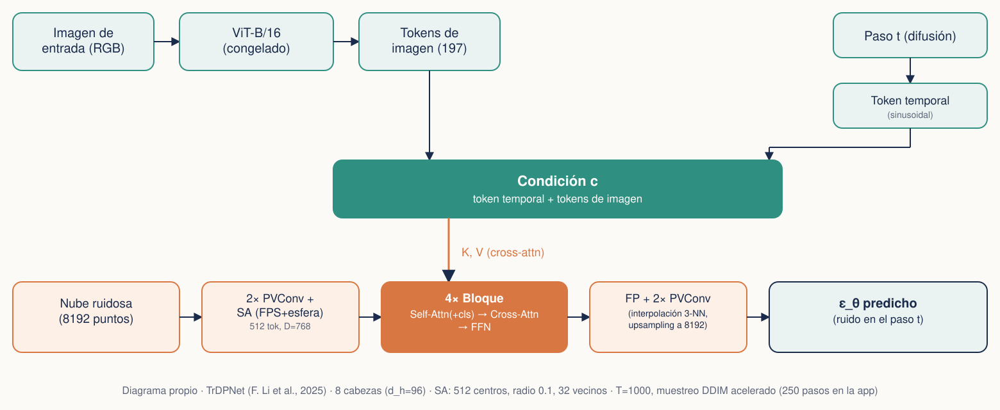
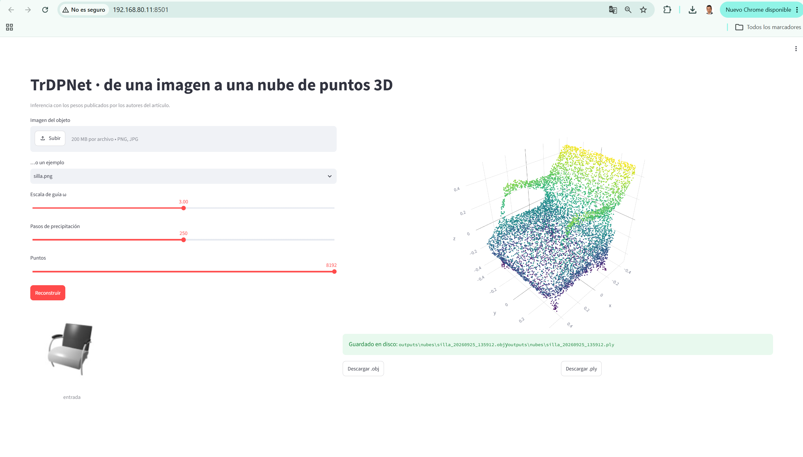

# TrDPNet — Reconstrucción 3D de nubes de puntos a partir de una sola imagen

Proyecto Final · Procesamiento de Datos Secuenciales
Julián René Muñoz Burbano · Valentina Isaza Ospina · Nelcy Zapata Gil
Docente: PhD(c). Natali Johana Velandia Fajardo

---

## Resumen

Este repositorio implementa y evalúa **TrDPNet**, un modelo de difusión basado en Transformers para reconstruir la nube de puntos 3D de un objeto a partir de una única imagen 2D (Li et al., 2025). El trabajo usa los **pesos oficiales preentrenados por los autores**, no un modelo entrenado por el equipo, y se concentra en cuatro cosas: (1) eliminar la dependencia de PyTorch3D reescribiendo en PyTorch puro las operaciones geométricas que el modelo necesita, (2) verificar de forma numérica y reproducible, celda a celda, que el mecanismo de atención (Q, K, V) hace exactamente lo que describe el artículo, (3) evaluar el modelo con las métricas del artículo y con métricas propias, categoría por categoría, y (4) desplegar una interfaz interactiva (Streamlit) para generar reconstrucciones a partir de imágenes nuevas. El resultado es una reproducción funcional, verificada capa por capa, con un hallazgo propio no reportado en el artículo original (ver Resultados y Conclusiones).

## Introducción

**Artículo base:** F. Li, T. Li, K. Xiao, L. Wang, L. Yu, "TrDPNet: A transformer-based diffusion model for single-image 3D point cloud reconstruction," *Journal of Visual Communication and Image Representation*, vol. 111, art. 104503, 2025. DOI: [10.1016/j.jvcir.2025.104503](https://doi.org/10.1016/j.jvcir.2025.104503).

**Repositorio original de los autores:** [github.com/TLab512/TrDPNet](https://github.com/TLab512/TrDPNet).

**El problema.** Reconstruir la forma 3D completa de un objeto a partir de una sola imagen 2D es un problema muy poco restringido: al mirar una sola cara de un objeto, hay muchas geometrías distintas por el lado que no se ve que serían igual de consistentes con esa foto. Los métodos anteriores basados en aprendizaje profundo (Pixel2Mesh, Point2Vox, RGB2Point, entre otros) abordan esto de formas distintas, pero el antecedente más directo de TrDPNet es **PC²** (Melas-Kyriazi et al., 2023): un modelo de difusión que también parte de ruido y lo va limpiando hasta obtener una nube de puntos, pero que inyecta la información de la imagen **proyectando geométricamente** cada punto de la nube sobre el plano de la imagen usando matrices de cámara, y tomando el color/característica de ese píxel. Es un mecanismo efectivo, pero según señalan los propios autores de TrDPNet, es *local*: cada punto solo puede "ver" el pixel exacto donde cae su proyección, y esa dependencia de una proyección geométrica explícita limita qué tan bien se integra la información visual en el resto de la red.

**La motivación de TrDPNet.** En lugar de esa proyección fija, TrDPNet deja que un mecanismo de **cross-attention** aprenda, durante el entrenamiento, qué partes de la imagen son relevantes para cada zona de la nube que se está reconstruyendo — sin necesitar una cámara ni una proyección explícita. Es la misma idea de fondo que permite a un Transformer de traducción decidir "a qué palabra de la oración en español debo prestar atención para generar la siguiente palabra en inglés", aplicada aquí a "a qué zona de la imagen debo prestar atención para generar este punto de la nube".

**Objetivo de este proyecto.** El curso no pide entrenar un Transformer completo desde cero — sería computacionalmente inviable para un proyecto de este alcance —, sino tomar un modelo ya entrenado (encoder-decoder, con código y pesos disponibles) y trabajar con él en modo inferencia. Concretamente, nuestro objetivo fue: (a) reproducir la arquitectura de TrDPNet de forma que corra con los pesos oficiales en cualquier máquina, sin las dependencias fragiles del repositorio original; (b) verificar, con evidencia reproducible, que el mecanismo de atención hace lo que el artículo dice que hace; y (c) desplegarlo como una herramienta interactiva.

## Marco teórico

### 1. Conceptos previos, aplicados directamente a este proyecto

Antes de entrar en la arquitectura, estos son los conceptos base de un Transformer, definidos aquí no de forma genérica sino apuntando a la pieza exacta de TrDPNet a la que corresponden:

| Concepto | Definición general | En TrDPNet, concretamente |
|---|---|---|
| **Encoder** | Transforma una entrada en una representación interna (vector o secuencia de tokens) | El **ViT-B/16 congelado** convierte la imagen en 197 tokens; el extractor **PVCNN+SA** convierte la nube ruidosa en 512 tokens |
| **Decoder** | Transforma la representación interna de vuelta en la salida deseada | La capa de **propagación de características (FP)**, que interpola los 512 tokens de vuelta a una predicción por cada uno de los 8192 puntos |
| **Input** | Lo que entra al sistema | Imagen RGB 224×224, una nube de ruido puro de 8192 puntos, y el paso de difusión t |
| **Output** | Lo que produce el sistema | En cada paso: una estimación del ruido ε_θ (una coordenada x,y,z por punto). Al final del proceso completo: la nube reconstruida |
| **Self-attention** | Cada elemento de una secuencia compara su información con los demás elementos de la *misma* secuencia | Los tokens de la nube se comparan entre sí, para entender cómo se relacionan distintas zonas del objeto que se está reconstruyendo |
| **Cross-attention** | Una secuencia compara su información con una *segunda* secuencia distinta | Los tokens de la nube (Q) comparan su información contra los tokens de la imagen + el token temporal (K, V) — la innovación central del artículo |

### 2. Visión general del pipeline



1. La **imagen de entrada** (redimensionada a 224×224) pasa por un **ViT-B/16 preentrenado y congelado** (no se reentrena), que produce 197 tokens de imagen (196 parches de 16×16 + 1 token de clase).
2. El **paso de difusión t** se codifica con la codificación sinusoidal clásica del Transformer original — un **token temporal**.
3. Tokens de imagen y token temporal se concatenan en la **condición c**.
4. La **nube de puntos ruidosa** (8192 puntos) pasa por un extractor geométrico híbrido tipo *Point-Voxel CNN*, que produce 512 tokens de dimensión 768, más un token de clase adicional (513 en total), con una codificación posicional propia.
5. Esos tokens entran a **4 bloques Transformer en cascada**, cada uno con self-attention, cross-attention y una red feed-forward.
6. Una capa de **propagación de características (FP)** reconstruye la predicción para los 8192 puntos originales.
7. Esa predicción de ruido se usa, con la fórmula de DDPM, para dar un paso de limpieza y repetir el proceso hasta obtener la nube final.

Las siguientes secciones explican cada pieza de este pipeline con el código real del proyecto (`streamlit_app/trdpnet_lib.py`), función por función.

### 3. El extractor geométrico: de una nube de puntos a tokens

TrDPNet no usa directamente los 8192 puntos como tokens (sería computacionalmente muy costoso pasar 8192 elementos por un Transformer). En vez de eso, los resume primero en 512 tokens usando ideas de dos arquitecturas clásicas de aprendizaje sobre nubes de puntos: **PointNet++** (para elegir y agrupar puntos representativos) y **Point-Voxel CNN** (Liu et al., 2019) (para extraer características locales de forma eficiente combinando una rama de vóxeles con una rama por punto).

- **`muestreo_mas_lejano(coords, m)`** — implementa *farthest point sampling*: elige un punto inicial y, repetidamente, el punto más lejano a todos los ya elegidos, hasta tener `m` centros. Esto reparte los centros por toda la superficie del objeto en vez de concentrarlos donde hay más densidad de puntos.
- **`consulta_esfera(centros, puntos, radio, k)`** — para cada centro, busca hasta `k` vecinos dentro de un radio fijo (*ball query*); si hay menos de `k` puntos en el radio, repite el primero encontrado para completar el tamaño fijo del grupo.
- **`agrupa(features, idx)`** — reorganiza las características de los puntos según los índices de vecinos encontrados en el paso anterior.
- **`voxeliza` / `desvoxeliza`** — convierten la nube de puntos en una rejilla 3D regular (vóxeles) promediando las características que caen en cada celda, y el proceso inverso, muestreando la rejilla en las coordenadas continuas de cada punto por interpolación trilineal. Esto es lo que permite aplicar convoluciones 3D normales (`nn.Conv3d`) sobre datos que originalmente no tienen una rejilla regular.
- **`PVConv`** — combina las dos ramas: una rama "de vóxel" (voxeliza → convoluciones 3D con normalización y activación Swish → recalibración de canales `SE3d` → desvoxeliza) y una rama "por punto" (un MLP compartido aplicado directamente a cada punto), y las **suma**. Esto captura tanto contexto local de vecindad (rama de vóxel) como detalle fino por punto (rama de punto).
- **`PointNetSAModule`** — la capa de abstracción final: usa `muestreo_mas_lejano` para elegir 512 centros, `consulta_esfera` para agrupar hasta 32 vecinos por centro dentro de un radio de 0.1, y un MLP compartido + max-pooling para resumir cada grupo de vecinos en un solo vector de dimensión 768 por centro.
- **`PVCNN2SA`** — encadena dos `PVConv` (que refinan las características punto a punto, todavía sobre los 8192 puntos) y luego el `PointNetSAModule` (que reduce a los 512 tokens finales). Esta es la pieza que en las diapositivas llamamos simplemente "capa SA."
- **`PointNetFPModule`** — la propagación inversa: para cada uno de los 8192 puntos originales, busca sus 3 centros más cercanos (de los 512) y combina sus características ponderando por el inverso de la distancia (interpolación por vecinos más cercanos).
- **`PVCNN2FP`** — encadena la interpolación anterior con dos `PVConv` más y una capa clasificadora final (`Conv1d` a 3 canales) que produce la predicción de ruido por punto. Esta es la capa "FP" del diagrama.

### 4. El encoder de imagen (ViT-B/16 congelado)

- **`ViT`** — una implementación estándar de Vision Transformer, con los mismos nombres de parámetros que usa la librería `timm` (para poder cargar los pesos oficiales sin conflictos): divide la imagen en parches de 16×16 con una convolución (`patch_embed.proj`), les añade un token de clase y una codificación posicional **aprendida como parámetro libre** (`pos_embed`, un tensor de forma (1, 197, 768) que se ajustó durante el preentrenamiento del ViT), y los pasa por 12 bloques Transformer estándar (`BloqueViT`, cada uno con su propia self-attention y MLP).
- **`ModeloRasgos`** — envuelve el ViT anterior y le aplica la normalización estándar de ImageNet (restar la media y dividir por la desviación estándar de cada canal de color) antes de pasar la imagen, tal como se preentrenó el modelo original.
- Este encoder se carga con **`strict=False`** (a diferencia de la red de difusión): es un ViT genérico reutilizado, no la parte "propia" del artículo, así que no se exige una coincidencia exacta de todos los parámetros.

### 5. El Transformer del artículo: self-attention, cross-attention y la condición

- **`codifica_paso(embed_dim, timesteps, device)`** — la codificación **sinusoidal** del paso de difusión t, idéntica a la codificación posicional del Transformer original ("Attention is all you need"): frecuencias decrecientes de seno y coseno, de forma que cada valor de t produce un vector distinguible.
- **`Attention`** — el módulo de atención multi-cabeza, con **una sola matriz de proyección** que produce Q, K y V a la vez (`nn.Linear(dim, dim*3)`) y luego los separa. Guarda opcionalmente el mapa de atención (`self.ultimo_mapa`) para poder analizarlo después — esta es la pieza que se usaría si se genera un mapa de atención visual.
- **`TransformerBlock`** — el bloque que se repite 4 veces. En el código real, tanto el paso de "self-attention" como el de "cross-attention" se implementan aplicando el mismo tipo de atención sobre la **concatenación** de la condición `c` y los tokens de la nube `x` (en distinto orden cada vez), y luego quedándose solo con la porción de la salida que corresponde a `x`. Como la proyección lineal que calcula Q, K y V se aplica de forma independiente a cada token (fila por fila), esto es matemáticamente equivalente a la formulación simple **Q = x·Wq, K = c·Wk, V = c·Wv** que se usa en la tabla de la siguiente sección — es la forma en que el propio equipo de Julián verificó el mecanismo (ver punto 7) — con una salvedad técnica: dentro de esa operación conjunta, los tokens de `x` también pueden atender entre sí en el mismo paso, no solo a `c`. Para la sustentación, la formulación simple es la correcta y suficiente; esta nota queda aquí por si se pide ver el código exacto.
- **`TransformerEncoder`** — simplemente apila 4 `TransformerBlock` en secuencia.
- **`TrDPNetOficial`** — la clase que junta todo: llama al extractor geométrico (`PVCNN2SA`) para obtener los 512 tokens de la nube, les agrega el token de clase y la codificación posicional aprendida sobre las coordenadas de los centros, arma la condición `c` (token temporal + tokens de imagen), pasa todo por los 4 bloques Transformer, y llama al decodificador (`PVCNN2FP`) para producir la predicción final de ruido sobre los 8192 puntos.

### 6. Interpretación de Q, K y V para nuestro problema

| Mecanismo | Q (consultas) | K y V (claves / valores) |
|---|---|---|
| Self-attention (ViT-B/16, congelado) | Parches de la imagen de entrada | Los mismos parches de la imagen |
| Self-attention (sobre la nube de puntos) | Tokens de la nube ruidosa que se reconstruye | Los mismos tokens de la nube ruidosa |
| **Cross-attention** (innovación central) | Tokens de la nube (lo que se está generando) | Tokens de imagen (ViT) + token del paso temporal t |

En palabras simples: cada punto de la nube "pregunta" (Query) qué forma debe tener en su zona; esa pregunta se compara contra la imagen (Key/Value) para decidir hacia dónde moverse. Esto sustituye la proyección geométrica fija de PC² por atención aprendida.

### 7. Verificación numérica manual, paso a paso

El notebook complementario **`TrDPNet_a_mano.ipynb`** reproduce el cálculo completo del modelo en una versión en miniatura — 8 puntos en vez de 8192, 3 tokens en vez de 512, dimensión 4 en vez de 768, una imagen de 4×4 píxeles en vez de 224×224 — con la idea de que cada matriz que aparece quepa, literalmente, en una hoja y pueda revisarse a mano. El recorrido es:

1. **Las entradas.** Una nube de 8 puntos con la silueta reconocible de una silla en miniatura, una imagen de 4×4 dividida en 4 parches de 2×2 (igual que el ViT real divide 224×224 en parches de 16×16), y un paso de difusión t.
2. **Capa SA: de 8 puntos a 3 tokens.** Muestreo por punto más lejano, agrupación por esfera, y resumen a 3 tokens — la misma secuencia de 4 pasos que en el modelo real, solo que con números pequeños.
3. **La condición.** El paso temporal se codifica con la fórmula sinusoidal $e_{2i}=\sin(t/10000^{2i/d})$, $e_{2i+1}=\cos(t/10000^{2i/d})$, y se concatena con los tokens de la imagen.
4. **Q, K y V.** Tres proyecciones lineales: $Q = xW_q$ (de los tokens de la nube), $K = cW_k$, $V = cW_v$ (de la condición) — la asimetría que define la cross-attention.
5. **La atención, celda a celda.** $S = QK^\top/\sqrt{d_h}$ (afinidad entre cada pregunta y cada etiqueta), $A=\mathrm{softmax}(S)$ (normalización), $O = AV$ (combinación ponderada del contenido).
6. **Conexión residual y avance directo.** $x' = x + \text{Atención}(x,c)$, $x'' = x' + \text{MLP}(x')$: cada sub-bloque aporta una corrección sobre lo que ya había, no lo reemplaza.
7. **Capa FP: de 3 tokens a 8 vectores de ruido.** Interpolación ponderada por el inverso de la distancia a los 3 centros: $f(p)=\sum_i w_i f(c_i)$, $w_i = (1/d_i)/\sum_j(1/d_j)$.
8. **Guía sin clasificador.** $\hat\epsilon = \epsilon_\theta(x_t,\varnothing,t) + \omega\big(\epsilon_\theta(x_t,c,t)-\epsilon_\theta(x_t,\varnothing,t)\big)$ — la diferencia entre la predicción condicionada y la no condicionada es, literalmente, lo que aporta la imagen.
9. **Verificación contra PyTorch.** Se ejecuta la misma secuencia con los módulos reales de PyTorch (incluida su implementación de atención) y se compara resultado contra resultado. **La diferencia máxima observada es de 2.1×10⁻⁴** — del orden de la precisión numérica de la máquina, lo que confirma que el desarrollo manual no es una simplificación didáctica sino exactamente la operación que ejecuta la biblioteca.

### 8. El proceso de difusión: cómo se llega de ruido puro a una nube de puntos

- **`DifusionOficial`** — define el programa de ruido (*noise schedule*) del artículo: 1000 pasos, con una secuencia de $\beta_t$ que crece linealmente entre 0.00085 y 0.012. A partir de ahí calcula $\alpha_t = 1-\beta_t$ y su producto acumulado $\bar\alpha_t$, que es lo que se usa para mezclar la señal original con ruido en cualquier paso `t` de una sola vez (`q_sample`), sin tener que simular los t pasos intermedios uno por uno.
- **`muestrea_oficial`** — implementa el Algoritmo 2 del artículo: el muestreo inverso con guía sin clasificador. Parte de ruido puro $x_T \sim \mathcal{N}(0,I)$ y, para cada paso, evalúa el modelo **dos veces** (una con la condición real, otra con la condición anulada — los tokens de imagen sustituidos por ceros) y combina ambas predicciones con la fórmula de guía de la sección anterior. Cuando se pide un número de pasos menor a T=1000 (como los 250 que usan por defecto el notebook y la app), en vez de recorrer los 1000 pasos completos, salta entre un subconjunto de ellos usando la **actualización determinista de DDIM** (Song et al., 2021) — una forma estándar y ya demostrada de acelerar el muestreo sin reentrenar el modelo ni perder calidad de forma notable.

### 9. Positional encoding (uno de los puntos que exige la profesora)

No hay un solo tipo: el modelo usa **tres codificaciones posicionales distintas, cada una donde tiene sentido**:
- **Sinusoidal** (fija, no aprendida) para el paso de difusión t — la misma fórmula del Transformer original, ver punto 5 y 7.3.
- **Aprendida a partir de coordenadas** para los tokens de la nube: un MLP de dos capas (`Linear(3,128) → GELU → Linear(128,768)`) que convierte la posición (x,y,z) de cada uno de los 512 centros en un vector sumado al token correspondiente.
- **Aprendida como parámetro libre** para los parches del ViT (`nn.Parameter` de forma (1, 197, 768)), el esquema estándar de un Vision Transformer, ajustado durante el preentrenamiento.

### 10. Por qué la arquitectura es innovadora

El propio artículo reporta dos ablaciones que sustentan esto (Tabla 3 del artículo, F-score a τ=0.01): quitar la **cross-attention** hace que el modelo **no pueda incorporar ninguna información de la imagen**, fallando por completo en la reconstrucción guiada — es la pieza que reemplaza la proyección geométrica de PC²; quitar la **self-attention** entre tokens de la nube reduce el F-score de 0.389 a 0.381, un efecto menor pero consistente, asociado a la modelación de contexto global entre puntos (cada punto entiende mejor su lugar en el objeto completo si puede "ver" a los demás puntos, no solo a la imagen). Nuestra propia evaluación confirma la magnitud del primer efecto de forma mucho más marcada: condicionar con la imagen mejora el F-score propio en un **+164.8% en promedio** frente a anular la condición (ver Resultados).

## Metodología

1. **Elección del artículo y registro:** artículo encoder-decoder con código y pesos disponibles (requisito del curso), registrado según las reglas de "primero en llegar, primero en servir."
2. **Reescritura sin PyTorch3D:** las operaciones geométricas que el artículo original resuelve con extensiones CUDA de PyTorch3D (*farthest point sampling*, *ball query*, voxelización, devoxelización trilineal) se reescribieron en PyTorch puro, verificando cada una por separado antes de integrarlas al modelo completo.
3. **Carga de los pesos oficiales:** un desempaquetador de *pickle* tolerante abre el checkpoint sin necesitar instalar el repositorio original; los tensores de la red de difusión se cargan con `strict=True` (coincidencia exacta) y los del ViT congelado con `strict=False`.
4. **Verificación del mecanismo de atención:** notebook complementario en miniatura, comparado numéricamente contra PyTorch.
5. **Evaluación:** métricas del artículo (F-score) y una propia (distancia de Chamfer), con un experimento propio de ablación (con imagen / sin imagen / nube aleatoria) por cada una de las 13 categorías de ShapeNet usadas.
6. **Despliegue:** aplicación interactiva en Streamlit para inferencia con imágenes nuevas.

## Desarrollo e implementación (manual de uso)

**Estructura del repositorio:**
```
TrDPNet_oficial_v13G.ipynb   # notebook principal (arquitectura, carga de pesos, evaluación, figuras)
TrDPNet_a_mano.ipynb         # verificación manual del mecanismo de atención, en miniatura
streamlit_app/
  app.py                     # interfaz web de inferencia
  trdpnet_lib.py             # arquitectura + muestreo, reutilizados por notebook y app
weights/
  TrDPNet_shapenet.pth       # checkpoint oficial de los autores (no se versiona en git por tamaño)
ejemplos/                    # imágenes de ejemplo para probar la app
outputs/                     # métricas, nubes reconstruidas, animaciones, figuras
requirements.txt
```

**Librerías necesarias** (`requirements.txt`): `numpy`, `pandas`, `matplotlib`, `torch`, `pillow`, `ipywidgets`, `plotly`, `streamlit`, `jupyterlab`. No se necesita PyTorch3D ni ninguna extensión compilada con `nvcc`.

**Instalación:**
```bash
pip install -r requirements.txt
```

**Pesos:** descargar `TrDPNet_shapenet.pth` (publicado por los autores) y colocarlo en `weights/TrDPNet_shapenet.pth`. El archivo es un checkpoint de entrenamiento que guarda, además de los pesos, objetos de configuración propios del repositorio de los autores. Para poder abrirlo sin instalar ese repositorio, `app.py` define un desempaquetador de *pickle* tolerante: una clase `_Fantasma` que sustituye silenciosamente cualquier clase que Python no pueda encontrar, y una función `_busca_sd` que recorre el objeto cargado buscando el diccionario con más tensores dentro — ese diccionario es el verdadero *state dict* del modelo. Los pesos de la red de difusión (con el prefijo `point_cloud_model.` en el checkpoint original) se cargan en modo estricto; los del ViT (prefijo `feature_model.model.`) en modo no estricto.

**Ejecutar el notebook principal:** abrir `TrDPNet_oficial_v13G.ipynb` en Jupyter y ejecutar todas las celdas. Genera las métricas, las nubes reconstruidas, las animaciones y las figuras de este documento.

**Ejecutar la verificación manual** (no necesita pesos ni conjunto de datos, corre en segundos):
```bash
jupyter nbconvert --to notebook --execute TrDPNet_a_mano.ipynb
```

**Levantar la aplicación interactiva:**
```bash
streamlit run streamlit_app/app.py
```
La app permite subir una imagen (o elegir un ejemplo de `ejemplos/`), ajustar la escala de guía ω (1.0 a 5.0), el número de pasos de muestreo (50 a 1000) y el número de puntos (1024 a 8192), y descargar la nube reconstruida en `.obj` y `.ply`. Cada reconstrucción se guarda automáticamente en `outputs/nubes/`.

**Muestreo (nota técnica):** la difusión se define con T=1000 pasos (mismo programa de ruido del artículo), pero tanto el notebook de evaluación como la app usan por defecto **250 pasos** con la actualización determinista de DDIM — una forma estándar de acelerar el muestreo sin reentrenar el modelo, contemplada por el propio algoritmo de muestreo con guía del artículo.

## Resultados y análisis



*Reconstrucción de una silla a partir de su imagen, con los pesos oficiales, ω=3.0 y 250 pasos de muestreo (8192 puntos).*

### Métricas globales

| Métrica | Valor propio | Artículo | Qué mide |
|---|---|---|---|
| F-score (con imagen) | 0.746 | 0.389 | calidad de la reconstrucción condicionada |
| F-score (sin imagen, condición anulada) | 0.282 | — | el mismo modelo sin usar la imagen |
| F-score (nube aleatoria) | 0.097 | — | piso de referencia |
| Ganancia por usar la imagen | **+164.8%** | — | efecto medible de la cross-attention |
| Distancia de Chamfer (con imagen) | 0.0075 | — | error geométrico medio (agregada por el equipo) |
| Escala de guía óptima (ω) | 3.0 | 2.5–3.0 | punto óptimo de la guía sin clasificador |
| Error de Q, K, V vs. PyTorch | 2.1×10⁻⁴ | — | verificación del mecanismo de atención |
| Entropía de la atención cruzada | 21% del máximo | — | atención selectiva, no degenerada |
| Parámetros de la red de difusión | 38 386 307 (≈38M) | ≈38M | carga en modo estricto |
| Parámetros del ViT congelado | 85 798 656 (≈86M) | — | codificador de imagen reutilizado |
| Tiempo de inferencia por objeto | 23.1 s | — | 250 pasos × 2 evaluaciones (con/sin condición), GPU |

**Aclaración metodológica importante:** nuestro F-score usa una tolerancia τ=0.05; el artículo reporta explícitamente τ=0.01 en su ablación (Tabla 3), y esa tabla comparte el mismo promedio (0.389) con la tabla de escala de guía (Tabla 2) de la que se tomó la columna "artículo" — lo que indica que ambas tablas del artículo usan ese mismo umbral, más estricto que el nuestro. Esto explica buena parte de la diferencia entre 0.746 y 0.389: **no es una comparación directamente equivalente**, y debe presentarse así en la sustentación, no como una mejora de +92% sobre el artículo.

**Escala de guía (ω): barrido propio.** F-score con imagen según ω: 0.846 (ω=1.0), **0.871 (ω=3.0, óptimo)**, 0.805 (ω=5.0) — la misma curva en forma de U que reporta el artículo, con el máximo en el mismo rango (2.5–3.0).

### Resultados por categoría (ShapeNet, ω=3.0)

| Categoría | F con imagen | F sin imagen | Ganancia | F artículo (Tabla 2, ω=3.0) |
|---|---|---|---|---|
| avión | 0.831 | 0.165 | +402.4% | 0.576 |
| banca | 0.881 | 0.340 | +159.2% | 0.441 |
| armario | 0.813 | 0.282 | +188.0% | 0.319 |
| auto | 0.912 | 0.171 | +432.4% | 0.428 |
| silla | 0.756 | 0.395 | +91.3% | 0.337 |
| pantalla | 0.528 | 0.385 | +37.1% | 0.258 |
| lámpara | 0.785 | 0.264 | +197.3% | 0.357 |
| parlante | 0.852 | 0.279 | +204.8% | 0.221 |
| rifle | 0.928 | 0.104 | +796.4% | 0.582 |
| **sofá** | 0.510 | 0.600 | **−15.0%** | 0.272 |
| mesa | 0.993 | 0.304 | +226.6% | 0.471 |
| teléfono | 0.834 | 0.188 | +343.4% | 0.404 |
| **embarcación** | 0.078 | 0.184 | **−57.9%** | 0.392 |
| **promedio** | **0.746** | **0.282** | **+231.2%** | **0.389** |

**Hallazgo propio (no reportado en el artículo):** en 11 de las 13 categorías, usar la imagen mejora el F-score entre un 37% y un 796%. En **sofá** y **embarcación**, ocurre lo contrario: usar la imagen **empeora** la reconstrucción (−15.0% y −57.9% respectivamente) frente a generar sin condicionar. Embarcación es además la única categoría donde el resultado propio (0.078) queda muy por debajo de lo reportado por el artículo (0.392) — en las otras 12 categorías el resultado propio supera al del artículo. Una hipótesis razonable es que ambas categorías tienen formas delgadas, huecas o con alta variabilidad interna (cascos, cojines, superficies cóncavas) que el conjunto de puntos representa mal, y que en esos casos la cross-attention termina introduciendo una guía visual poco fiable en vez de ayudar — mientras que categorías con formas más "sólidas" y de silueta simple (mesa, auto, rifle) se benefician enormemente de la condición.

## Conclusiones

- **Los pesos usados son los oficiales, no una réplica reducida:** la red de difusión (38.4M parámetros) carga en modo estricto (`strict=True`) contra el checkpoint de los autores — coincidencia exacta de nombres y formas de cada tensor —, y el ViT (86M parámetros) se reutiliza congelado con carga no estricta por ser un encoder genérico. 124.2M parámetros en total, sin entrenamiento propio.
- **El mecanismo de atención funciona como describe el artículo:** verificado numéricamente, celda a celda, con un notebook complementario en miniatura (error de 2.1×10⁻⁴ frente a PyTorch), y confirmado a nivel de comportamiento por el efecto medible de la cross-attention en las métricas (+164.8% de ganancia promedio al usar la imagen).
- **Se logró independencia total de PyTorch3D:** las cuatro operaciones geométricas (farthest point sampling, ball query, voxelización, devoxelización trilineal) se reescribieron y verificaron en PyTorch puro; el proyecto corre en cualquier máquina con PyTorch instalado, sin `nvcc` ni extensiones CUDA compiladas.
- **Limitación 1 — estocasticidad:** la difusión genera una reconstrucción distinta en cada corrida; no se usó aquí el protocolo Oracle (generar varias muestras y quedarse con la mejor), lo que es una mejora pendiente para reducir esa variabilidad en la evaluación.
- **Limitación 2 — comparación de métricas:** nuestro F-score (τ=0.05) no es directamente comparable con el del artículo (τ=0.01); una evaluación adicional a τ=0.01 daría una comparación justa.
- **Limitación 3 — anomalía sofá/embarcación:** hallazgo propio, sin explicación reportada en el artículo; requiere más investigación, probablemente relacionada con la geometría delgada/hueca de esas categorías.
- **Limitación 4 — fragilidad del enlace de pesos:** la carga estricta exige coincidencia exacta de nombres y formas de cada tensor; cualquier cambio futuro en la arquitectura rompería esa compatibilidad con el checkpoint oficial.
- **Recursos de cómputo:** 23.1 segundos por objeto en GPU (250 pasos de muestreo × 2 evaluaciones, por la guía sin clasificador). Esto hace viable ejecutar el modelo de forma interactiva, como en la app de Streamlit, sin tiempos de espera prohibitivos — aunque una evaluación completa del conjunto de prueba (578 segundos en este caso) sigue siendo un costo no trivial de GPU, relevante si se quisiera escalar la evaluación a un conjunto de datos más grande.

## Referencias

[1] F. Li, T. Li, K. Xiao, L. Wang, and L. Yu, "TrDPNet: A transformer-based diffusion model for single-image 3D point cloud reconstruction," *J. Vis. Commun. Image Represent.*, vol. 111, art. no. 104503, 2025.

[2] L. Melas-Kyriazi, C. Rupprecht, and A. Vedaldi, "PC²: Projection-conditioned point cloud diffusion for single-image 3D reconstruction," in *Proc. IEEE/CVF Conf. Comput. Vis. Pattern Recognit.*, 2023, pp. 12923–12932.

[3] J. Ho, A. Jain, and P. Abbeel, "Denoising diffusion probabilistic models," *Adv. Neural Inf. Process. Syst.*, vol. 33, 2020, pp. 6840–6851.

[4] A. Vaswani, N. Shazeer, N. Parmar, J. Uszkoreit, L. Jones, A. N. Gomez, Ł. Kaiser, and I. Polosukhin, "Attention is all you need," *Adv. Neural Inf. Process. Syst.*, vol. 30, 2017.

[5] Z. Liu, H. Tang, Y. Lin, and S. Han, "Point-Voxel CNN for efficient 3D deep learning," *Adv. Neural Inf. Process. Syst.*, vol. 32, 2019.

[6] J. Song, C. Meng, and S. Ermon, "Denoising diffusion implicit models," in *Proc. Int. Conf. Learn. Represent.*, 2021.

[7] A. Dosovitskiy, L. Beyer, A. Kolesnikov, D. Weissenborn, X. Zhai, T. Unterthiner, M. Dehghani, M. Minderer, G. Heigold, S. Gelly, J. Uszkoreit, and N. Houlsby, "An image is worth 16x16 words: Transformers for image recognition at scale," in *Int. Conf. Learn. Represent.*, 2021.

[8] A. X. Chang, T. A. Funkhouser, L. J. Guibas, P. Hanrahan, Q. Huang, Z. Li, S. Savarese, M. Savva, S. Song, H. Su, J. Xiao, L. Yi, and F. Yu, "ShapeNet: An information-rich 3D model repository," *arXiv:1512.03012*, 2015.
