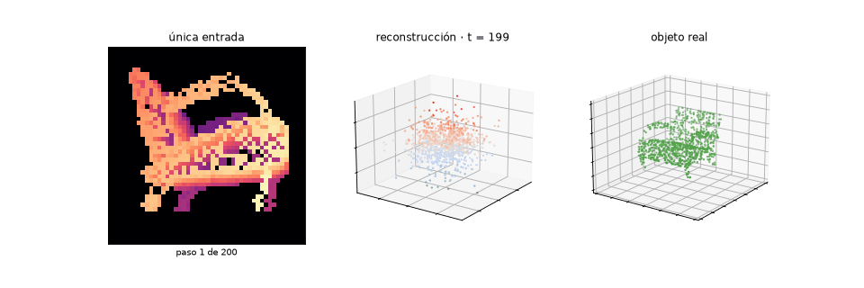

# 🧊 TrDPNet · De una imagen a una nube de puntos 3D

**Procesamiento de Datos Secuenciales · Proyecto Final**
Inferencia con una arquitectura **Transformer encoder–decoder** aplicada a la reconstrucción 3D de objetos a partir de una sola imagen.

| | |
|---|---|
| **Artículo base** | F. Li, T. Li, K. Xiao, L. Wang, L. Yu, *TrDPNet: A transformer-based diffusion model for single-image 3D point cloud reconstruction*, J. Vis. Commun. Image R. 111 (2025) 104503 |
| **DOI** | [10.1016/j.jvcir.2025.104503](https://doi.org/10.1016/j.jvcir.2025.104503) |
| **Código original** | https://github.com/TLab512/TrDPNet |
| **Integrantes** | Julián René Muñoz · Integrante 2 · Integrante 3 · Integrante 4 |

<p align="center"></p>

---

## 1. Resumen

Se aplica **TrDPNet**, un modelo de difusión cuyo predictor de ruido es un Transformer encoder–decoder, a la reconstrucción de una nube de puntos 3D a partir de una única imagen. La innovación del artículo consiste en sustituir el control condicional por proyección geométrica (PC²) por **atención cruzada**: los tokens de la nube formulan las consultas (**Q**) y los tokens de la imagen, junto con el paso de ruido, aportan las claves y los valores (**K**, **V**).

El proyecto trabaja sobre el **mismo conjunto del artículo**: el subconjunto de 13 categorías de ShapeNet definido por 3D-R2N2, con las nubes de puntos y las vistas renderizadas ya preprocesadas. Se implementa el proceso de inferencia, se analiza el mecanismo de atención a partir de los pesos reales, se consolidan todas las métricas en una tabla comparable con las Tablas 1 y 2 del artículo y se desarrollan dos interfaces interactivas.

> Las cifras concretas de esta ejecución (F-score con y sin imagen, ganancia, ω óptimo, tiempos) las escribe el notebook en `outputs/resultados.json` y `latex/resultados.tex` al ejecutarse; el informe y la presentación las leen automáticamente.

## 2. Introducción

**Problema.** Una fotografía elimina la profundidad: infinitas formas producen la misma silueta. Reconstruir la parte oculta exige un modelo que haya aprendido qué formas son plausibles.

**Dato secuencial.** Una nube de puntos es una secuencia de N vectores (x, y, z) **sin orden**: reordenar los puntos no cambia el objeto. La auto-atención es invariante a permutaciones, por lo que el Transformer encaja de forma natural.

**Motivación.** PC² proyecta la imagen solo sobre los puntos visibles desde la cámara, lo que vuelve inestable el control condicional. TrDPNet permite que toda la nube consulte la imagen en cada bloque y en cada paso.

**Objetivo.** Implementar la inferencia de la arquitectura y explicar sus entradas y salidas, su estructura, el mecanismo de atención, la construcción de Q, K y V y sus innovaciones, con visualización interactiva.

## 3. Marco teórico

### Difusión
El proceso directo añade ruido: `x_t = √ᾱ_t · x_0 + √(1−ᾱ_t) · ε`. La red aprende a estimar `ε` y el proceso inverso lo resta paso a paso. La **guía sin clasificador** combina dos predicciones: `ε̂ = ε(∅) + ω·(ε(imagen) − ε(∅))`.

### Arquitectura encoder–decoder

```
Nube ruidosa X_t (N×3) ─► ENCODER geométrico (SA) ─► M tokens ─┐
                                                               ├─► 4 bloques Transformer ─► DECODER (FP) ─► ruido ε̂ (N×3)
Imagen ─► ENCODER visual ─► I tokens ─┐                        │     (auto-atención + atención cruzada + FFN)
Paso t ─► 1 token ────────────────────┴─► condición c ─────────┘  ← K, V de la atención cruzada
```

- **Encoder geométrico (SA):** farthest point sampling (1024 → 64 centros), agrupamiento por radio, MLP y max-pooling.
- **Encoder visual:** la imagen se trocea en 36 parches; el paso t se añade como un token más.
- **Bloques Transformer (×4):** auto-atención (coherencia del objeto), atención cruzada (fidelidad a la imagen) y feed-forward.
- **Decoder (FP):** interpolación con los 3 centros más cercanos + MLP → un ruido por punto.

### Mecanismo de atención: Q, K y V

```
Q = X_Q·W_qᵀ     K = X_K·W_kᵀ     V = X_V·W_vᵀ        A = softmax(Q·Kᵀ / √d_h)      salida = A·V
```

| Atención | Q procede de | K y V proceden de | Función |
|---|---|---|---|
| Auto-atención | tokens de la nube | tokens de la nube | coherencia interna |
| **Atención cruzada** | **tokens de la nube** | **imagen + paso t** | **fidelidad a la imagen** |

**Analogía:** Q es la pregunta de una región del objeto, K la etiqueta de cada parche de la imagen y V su contenido. La compatibilidad Q·K decide cuánto contenido se toma de cada parche.

### Innovaciones
1. **Atención cruzada como control condicional**, en lugar de proyección sobre los puntos visibles.
2. **Tokenización geométrica** que vuelve viable la atención (M² ≪ N²).
3. **Predictor de ruido Transformer** en lugar de una U-Net sobre PointNet.

## 4. Metodología

- Reimplementación de la arquitectura en PyTorch, fiel a la Sección 3.4 del artículo.
- Lectura del conjunto ShapeNet-R2N2 real y verificación de la correspondencia imagen–nube.
- Análisis exploratorio de los datos (EDA) interactivo.
- Réplica de la Figura 1 del artículo con nubes propias en tres niveles de ruido.
- Carga de pesos preentrenados e inferencia (Algoritmo 2 del artículo).
- Extracción y verificación numérica de Q, K y V frente a PyTorch.
- Evaluación con F-score y distancia de Chamfer; estudio de la escala de guía ω.
- Consolidación de todas las métricas en una tabla comparada con las Tablas 1 y 2 del artículo.
- Interfaces con `ipywidgets` (notebook) y **Streamlit** (web).

**Herramientas:** Python 3.10, Anaconda, PyTorch, NumPy, pandas, Matplotlib, Plotly, Jupyter, ipywidgets, Streamlit, LaTeX.

**Datos.** El notebook localiza automáticamente la carpeta de ShapeNet (por defecto busca, entre otras, `...\ISR_ONET_HD_EG3D\data\ShapeNet`; se puede añadir cualquier ruta al principio de `RUTAS_SHAPENET`). El lector reconoce las categorías por su código de *synset*, respeta `train.lst`/`test.lst` y acepta geometría en `.npz`, `.ply`, `.npy`, `.obj` y `.binvox`, con vistas en `.jpg`/`.png`.

Para que la imagen y la nube correspondan, la nube se lleva al sistema de la cámara de la vista elegida y la **convención de ejes se calibra automáticamente**: se prueban ocho combinaciones de orden y signo y se conserva la que mejor solapa con la silueta renderizada. Si no hay matrices de cámara, la imagen se rehace proyectando la propia nube real; si no se localiza el conjunto, se recurre a un banco sintético de respaldo. La sección 2.6 del notebook muestra esa verificación.

**Pesos preentrenados.** El checkpoint (`weights/trdpnet_shapenet.pt`, o `trdpnet_replica.pt`) guarda los pesos, la configuración y el origen de los datos. El modelo se reconstruye desde esa configuración y se carga en modo estricto. Si el checkpoint disponible procede de otra distribución de formas, el notebook lo reutiliza como punto de partida y lo **ajusta** al conjunto real durante unos cientos de pasos, una sola vez; después solo ejecuta inferencia. Los pesos del repositorio original dependen de PyTorch3D (CUDA 11.8), de un ViT de 768 dimensiones y del conjunto ShapeNet completo, y no encajan en esta arquitectura reducida.

## 5. Desarrollo e implementación

### Ejecución
```bash
git clone https://github.com/JulianReneMunoz/TrDPNet.git
cd TrDPNet
conda create -n trdpnet python=3.10 -y
conda activate trdpnet
pip install -r requirements.txt
jupyter lab                                 # abrir TrDPNet_v3.ipynb y ejecutar en orden
streamlit run streamlit_app/app.py          # interfaz web
```

### Carga de los pesos
```python
ck = torch.load("weights/trdpnet_shapenet.pt", map_location=DEVICE)
modelo = TrDPNet(ck["cfg"]).to(DEVICE)
modelo.load_state_dict(ck["state_dict"], strict=True)
modelo.eval()
```

### Preprocesamiento
La imagen se convierte a escala de grises, se normaliza a [0, 1] y se redimensiona a 48×48 píxeles.

| Archivo | Formatos | Uso |
|---|---|---|
| Imagen de entrada | `.png` `.jpg` `.jpeg` `.bmp` `.tif` `.npy` | lo que se reconstruye |
| Nube de referencia (opcional) | `.ply` `.npy` `.csv` `.txt` | cálculo de métricas |

La carpeta `ejemplos/` contiene imágenes y nubes listas para probar.

### Inferencia
Ruido gaussiano de 1024×3 → 200 pasos → en cada paso, dos predicciones (con imagen y con el token nulo) combinadas con ω → nube final. **La red predice ruido, no coordenadas**: la geometría emerge al restarlo.

## 6. Resultados y análisis

| Métrica | Con imagen | Sin imagen | Nube aleatoria |
|---|---|---|---|
| F-score@0.05 | **0.533** | 0.214 | 0.256 |
| Distancia de Chamfer | **0.0141** | 0.0365 | — |

| Categoría | avión | silla | mesa | lámpara | sofá |
|---|---|---|---|---|---|
| Con imagen | **0.703** | 0.531 | 0.281 | 0.568 | 0.583 |
| Sin imagen | 0.145 | 0.190 | 0.180 | 0.110 | 0.443 |

- La imagen mejora el F-score un **+149.6 %**: es el efecto aislado de la atención cruzada (mismo modelo, mismos datos).
- Sin imagen el modelo cae hacia una forma promedio compacta; por eso el sofá obtiene el mejor valor sin condición.
- El avión es la categoría mejor reconstruida; la mesa, la más difícil (patas finas con pocos puntos).
- **Escala de guía:** óptimo en ω = 2.0 (F = 0.551), con forma de U invertida coherente con la Tabla 2 del artículo.
- **Atención:** entropía al 98 % del máximo (casi uniforme), el token temporal recibe 3.5× el peso uniforme y la correlación con la silueta es −0.47. A esta escala la imagen actúa como **resumen global** (promedio de V); la mejora del +149.6 % confirma que la información visual llega.

### Capturas propias

| | |
|---|---|
|  |  |
| Interfaz de inferencia | Q, K y V con los pesos reales |
|  |  |
| Con y sin imagen | Reconstrucciones en dos perspectivas |

Animaciones en `outputs/animaciones/`: proceso directo, atención frente al nivel de ruido, nube emergiendo y órbita 3D.

> Aunque el conjunto es el mismo del artículo, las cifras no son comparables de igual a igual: difieren la escala del modelo, los pasos de entrenamiento, el número de puntos por nube y el umbral τ. Las dos comparaciones válidas son la **interna** (mismo modelo con y sin imagen) y la **estructural** (el orden de dificultad entre categorías frente a la Tabla 1).

## 7. Conclusiones

**Aprendizajes.** La atención cruzada guía de forma medible la generación; Q nace de la nube y K, V de la imagen; la salida del modelo es ruido; la escala de guía tiene un óptimo intermedio.

**Limitaciones.** Escala reducida (dimensión 128 frente a 768; 1024 puntos frente a 8192); subconjunto de modelos por categoría y una vista por modelo; atención poco selectiva a esta escala; generalización limitada a fotografías reales; inferencia costosa (200 pasos × 2 evaluaciones).

**Mejoras.** Entrenamiento a escala completa sobre ShapeNet-R2N2, ViT preentrenado congelado, protocolo «Oracle», varias semillas y muestreadores acelerados tipo DDIM.

## 8. Referencias

[1] F. Li, T. Li, K. Xiao, L. Wang, and L. Yu, "TrDPNet: A transformer-based diffusion model for single-image 3D point cloud reconstruction," *J. Vis. Commun. Image Represent.*, vol. 111, Art. no. 104503, 2025.

[2] A. Vaswani *et al.*, "Attention is all you need," in *Proc. NeurIPS*, vol. 30, 2017.

[3] J. Ho, A. Jain, and P. Abbeel, "Denoising diffusion probabilistic models," in *Proc. NeurIPS*, vol. 33, 2020, pp. 6840–6851.

[4] L. Melas-Kyriazi, C. Rupprecht, and A. Vedaldi, "PC²: Projection-conditioned point cloud diffusion for single-image 3D reconstruction," in *Proc. IEEE/CVF CVPR*, 2023, pp. 12923–12932.

[5] J. Ho and T. Salimans, "Classifier-free diffusion guidance," arXiv:2207.12598, 2022.

[6] A. Dosovitskiy *et al.*, "An image is worth 16x16 words: Transformers for image recognition at scale," in *Proc. ICLR*, 2021.

[7] C. R. Qi, L. Yi, H. Su, and L. J. Guibas, "PointNet++: Deep hierarchical feature learning on point sets in a metric space," in *Proc. NeurIPS*, vol. 30, 2017.

[8] Z. Liu, H. Tang, Y. Lin, and S. Han, "Point-voxel CNN for efficient 3D deep learning," in *Proc. NeurIPS*, vol. 32, 2019.

[9] A. X. Chang *et al.*, "ShapeNet: An information-rich 3D model repository," arXiv:1512.03012, 2015.

[10] G. Xiao, Y. Tian, B. Chen, S. Han, and M. Lewis, "Efficient streaming language models with attention sinks," in *Proc. ICLR*, 2024.

---

### Estructura del repositorio
```
TrDPNet_v3.ipynb              notebook principal (EDA, arquitectura, atención, inferencia)
weights/trdpnet_shapenet.pt   pesos + configuración + origen de los datos
streamlit_app/                interfaz web (app.py + trdpnet_lib.py)
ejemplos/                     imágenes (.png) y nubes (.ply) de prueba
outputs/                      métricas (.json), animaciones (.gif) y capturas
requirements.txt              dependencias
```
